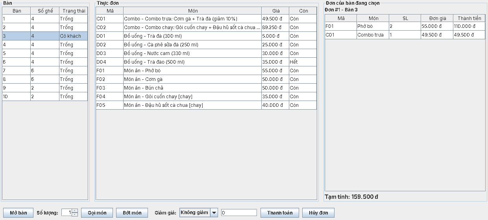

# Restaurant Ordering System

Bài tập lớn môn Lập trình hướng đối tượng (INT1332_CLC, PTIT), **chủ đề 8: hệ thống gọi món nhà hàng**.
Ứng dụng Java có hai giao diện dùng chung một tầng nghiệp vụ: console và Swing. Chức năng: mở bàn, gọi món, sửa món, thanh toán có giảm giá, hủy đơn, quản lý thực đơn và thống kê món bán chạy.

Thiết kế chi tiết: [`docs/superpowers/specs/2026-11-06-restaurant-ordering-design.md`](docs/superpowers/specs/2026-11-06-restaurant-ordering-design.md).

## Yêu cầu

- JDK 17 trở lên
- Maven 3.9 (NetBeans, IntelliJ, Eclipse đều có sẵn Maven)
- Lần build đầu cần có mạng để Maven tải JUnit và các plugin
- Nên chạy `mvn verify` một lần trên đúng máy và đúng JDK sẽ dùng khi demo

## Chạy

**Trong IDE:** mở thư mục dự án như một dự án Maven, chạy lớp `restaurant.Main`.

**Dòng lệnh:**

```bash
mvn verify                                      # biên dịch, chạy toàn bộ test, đo độ phủ
java -jar target/restaurant-ordering.jar        # chạy giao diện console
java -jar target/restaurant-ordering.jar --gui  # chạy giao diện Swing
```

Trong IDE, muốn mở giao diện Swing thì thêm tham số `--gui` vào cấu hình chạy của `restaurant.Main`.

Giao diện Swing: chọn bàn ở bảng bên trái, chọn món ở bảng giữa, rồi bấm các nút ở dưới.



Báo cáo độ phủ test nằm ở `target/site/jacoco/index.html` sau khi chạy `mvn verify`.

**Chạy kịch bản demo tự động** (dùng khi thuyết trình hoặc để kiểm tra nhanh):

```bash
java -jar target/restaurant-ordering.jar < scripts/demo-input.txt
```

Xóa thư mục `data/` trước khi chạy nếu muốn bắt đầu lại từ thực đơn mẫu.

## Dữ liệu

| File | Nội dung |
|---|---|
| `data/menu.csv` | Thực đơn. Tự tạo từ thực đơn mẫu nếu chưa có. Sửa tay được, nhưng phải lưu dạng UTF-8 (trong Excel chọn "CSV UTF-8"), phân cách bằng `;`. Dòng sai bị bỏ qua khi đọc nhưng vẫn giữ nguyên trong file |
| `data/hoa-don.txt` | Mọi hóa đơn đã thanh toán, ghi nối tiếp |

Đơn đang mở và trạng thái bàn không được lưu khi tắt app.

## Tiếng Việt trên cửa sổ cmd của Windows

App in ra UTF-8. Nếu cmd hiện sai dấu, chạy `chcp 65001` trước khi chạy app. Trong IntelliJ và NetBeans thường hiện đúng sẵn.

## Cấu trúc mã nguồn

| Gói | Vai trò |
|---|---|
| `restaurant.model` | Các lớp dữ liệu: `MenuItem` và lớp con (`Food`, `Drink`, `Combo`), `MenuItemFactory`, `Table`, `Order`, `OrderItem`, `Bill` |
| `restaurant.pricing` | Tính hóa đơn; các cách giảm giá theo pattern Strategy |
| `restaurant.repository` | Lưu trữ: interface `Repository<T, ID>` và `BillArchive`, bản bộ nhớ, bản file |
| `restaurant.service` | Nghiệp vụ: thực đơn, bàn, đơn |
| `restaurant.exception` | Lỗi nghiệp vụ, đều kế thừa `RestaurantException` |
| `restaurant.ui` | Giao diện console (`ConsoleMenu`, `InputReader`) và Swing (`ui.swing.MainWindow`) |
| `restaurant.common` | Dùng chung: định dạng tiền, định dạng hóa đơn |

## Các mốc trong git

| Tag | Nội dung |
|---|---|
| `milestone-4` | Bản cài đặt lõi (Milestone 4) |
| `milestone-5` | Refactor theo SOLID: Strategy, Factory, BillArchive, InputReader; thêm Combo (Composite) |

| `final` | Thêm giao diện Swing dùng chung service với console |
| `v1.0` | Bản nộp: bản `final` cộng các bản sửa lỗi sau khi review code |

Xem các thay đổi khi refactor: `git diff milestone-4 milestone-5 -- src/main`.

Chứng minh thêm giao diện Swing không phải sửa tầng nghiệp vụ (lệnh này in ra rỗng):

```bash
git diff milestone-5 final --stat -- src/main/java/restaurant/model src/main/java/restaurant/pricing src/main/java/restaurant/repository src/main/java/restaurant/service
```
